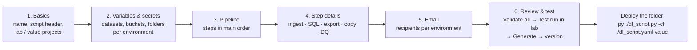

# Datapipeline Automation Hub: user guide

This guide covers building a pipeline from start to finish: from pasting your SQL to a script that follows the team's
production template, has been test-run in lab and is ready for your orchestrator. Every stage is listed below in the
order the wizard shows it.

- Running and operating a generated script: [RUNBOOK.md](RUNBOOK.md).
- Every key in the generated YAML: [CONFIG_REFERENCE.md](CONFIG_REFERENCE.md).

## Four ways to start

The home page has four cards above the list of processes:

| Card | What it makes |
|---|---|
| **New pipeline** | a process with any mix of steps: file ingestion, SQL, exports, copies, data-quality checks (the wizard below) |
| **Copy files** | copy or move files between buckets **right now**, from the browser (see [Copy files now](#copy-files-now)); or a process whose script does it every day (see [Copy-files process](#copy-files-process)) |
| **Enhance a script** | brings an existing script (and its YAML) up to the team standard (see [Enhance a script](#enhance-a-script)) |
| **Find files** | searches one or more buckets for a file name or pattern, in every folder (see [Find files](#find-files)) |

The **search box** at the top of every page finds processes by name, owner, team or tag: on the home page it filters
the list as you type; elsewhere press Enter to see the matches (everyone's processes).

Each of your own processes in the list has a small **delete** button (bin icon). It removes the process, its drafts and
all its saved versions for everyone, after a confirmation; it is meant for test processes. Scripts already deployed are
not touched. Only the owner sees it (co-owners do not).

## The process at a glance



| Stage | You decide | The hub does for you |
|---|---|---|
| 1. Basics | process + script name, header (authors, reviewers, JIRA/SN), lab and value projects | creates the process in the shared workspace; drafts autosave from then on |
| 2. Variables & secrets | per-environment values of datasets, buckets, folders; secrets | projects and datasets found in your SQL become variables with their lab values |
| 3. Pipeline | which steps, their function names, their order, stop/continue on failure | shows the exact `def main(args)`, warns when a step reads a table that a later step builds |
| 4. Step details | per step: files, SQL, extracts, copies, checks | lists the tables in your SQL, parameterizes it, proves it is unchanged, dry-runs it in lab |
| 5. Email | recipients per environment, when, subject, message, attachments | checks the addresses are comma separated; the sender and the relay are set by the hub |
| 6. Review & test | when you are done | checks everything in lab, test-runs it in lab, then renders the code and smoke-runs it offline |

The header shows two identities at the top right:

- **`ADC: <email>`** is the Google identity the hub uses for Gemini, BigQuery dry runs, GCS and Secret Manager checks
  and lab test runs. It is also the **email sender** written into the YAML. On a laptop it is your
  `gcloud auth application-default login` account; on Cloud Run, the hub's service account. When it is amber, there
  are no usable credentials.
- **Your email** is who you are signed in as. It decides who owns a process and who may save versions.

**Lab only.** The hub only ever uses the **lab** (dev) values to check or run anything. The **value** (prod) values are
written into the YAML and never used by the hub. Treat them like a deployment setting to review.

---

## Stage 1: Basics

1. **Process name** (`sales_daily`): lower_snake_case, 3–63 characters. It cannot change later; clone to rename.
2. **Description**: the program's purpose. It goes into the script header (*Description:*) and the README.
3. **Script header**: as in the team template.
   - **Author(s)**: PIDs, comma separated (`P10000, P12345`).
   - **Reviewer(s)**: PIDs, comma separated.
   - **JIRA/SN #**.
   - **Updates** lines (`[YYYY-MM-DD, PID]: what changed`).
   - *Created on* is filled in when the first version is saved.
4. **Script file name** (optional, e.g. `dl_script`): the script and its YAML share this name. The line next to it shows
   the command, with the environment last: `py ./dl_script.py -cf ./dl_script.yaml lab` (plus
   `-ts ./dl_script_table_schema.yaml` with a file ingestion). Replace `lab` by `value` to run with the prod block.
5. **Environments**: `read_project` (where the SQL reads) and `write_project` (where the process writes) for **lab
   (dev)** and **value (prod)**. In value (prod) both start as **`value-gcp`**, the team's prod project (the hub
   setting `SF_DEFAULT_PROJECT_VALUE`); type the lab ones. Turn on **qa** to add a third block.

Click **Next** to create the process; it needs at least the lab `write_project`. From then on, every change is saved
as a draft every couple of seconds.

There is no run date and no schedule: dates are relative to the day the script runs (or a value per environment in the
YAML), and your orchestrator decides when it runs.

## Stage 2: Variables & secrets

**Variables per environment** hold the datasets, buckets and folders that differ between lab and prod. Each has a
**group** (project, dataset, bucket, other) and one value per environment.
- SQL refers to them as `${name}`; step fields (bucket, folder, table names) as `{name}`.
- `read_project` and `write_project` are built in; `gsm_project` is added with the first secret.
- Values used in SQL may only contain letters, digits and `_ - . :`. Other values (folders, file names) may contain
  `/` and spaces, but not quotes or backslashes.
- Every variable a step uses needs a value for every environment before the code can be generated.
- **Used by** shows which steps use each variable.

You rarely type variables by hand: pasting SQL adds its projects (stage 4), and **Analyze & parameterize** adds its
datasets, each with its **lab** value. Fill in the **value (prod)** column.

**Secrets** (Google Secret Manager) are read at the start of `main()` by the script's `get_gsm_secret()` (the team's
`gsm_module`), from each environment's `gsm_project`, e.g. for an API key or a source-system connection. The script
keeps each secret's **whole payload** in `SECRETS["<name>"]`: a dict for JSON, e.g.
`{"api_credentials": [{"api": "…"}]}`, else the text. The steps pick what they need from it (see Custom process).

| Field | Meaning |
|---|---|
| Name | the key in the script's `SECRETS` dictionary |
| Secret id | the Secret Manager id, e.g. `pdw-source-connection` (the id, not the full path) |
| Version | `latest` (default) or a number such as `7` |
| What it holds | the layout of its payload, e.g. `api_credentials → api`; Gemini reads it when it writes a custom step |

**Check** reads the secret's metadata in lab (never its value): whether that version exists and is enabled.

## Stage 3: Pipeline

Add steps with the six buttons, or start from a template (*File → Table*, *Vendor drop → Table*, *SQL → Table*,
*SQL → FTP extract*).

| Step type | Generates | Typical use |
|---|---|---|
| **Ingest files** | the team's file-ingestion functions (pandas → staging → history → MERGE → archive) | daily CSV / TXT (delimited or fixed width) / JSON / Parquet drops |
| **Run SQL** | a function with your SQL embedded as an f-string | MERGE, INSERT, CREATE TABLE AS, scripts |
| **Export to GCS** | the team's `extract_data_file_csv` pattern (extract job) or `EXPORT DATA` | dated hand-off files, e.g. the FTP bucket |
| **Copy files** | `gcloud storage cp \| mv \| rsync` | move vendor drops, copy between buckets, to or from local folders |
| **Data quality** | small check queries | row counts, NOT NULL, unique keys, accepted values, freshness, custom SQL |
| **Custom process (AI)** | a function in the team standard whose body Gemini writes from your description | geocoding with an API key from Secret Manager, pulling from DB2 or another source system, any one-off logic |

For every step:
- **Function name**: the Python function (`def build_sales_daily_agg(write_project, data_sets)`). Unique,
  lower_snake_case, and not one of the script's own names (`main`, `email`, `process_file`, …).
- **What it does**: becomes the docstring, the comment above the call in `main()` and the README description.
- **On failure**: *stop* (the default) ends the run with the error. *Continue* logs it and moves on; the run still ends
  as failed.
- **Enabled**: a disabled step stays in the script, with its call commented out in `main()`.

The right-hand panel shows the exact `def main(args)`. The **Order check** warns when a step reads a table that a
*later* step builds; **Fix** moves the step for you.

One file-ingestion step per process: the script takes a single `-ts` table schema.

## Stage 4: Step details

Fields that take `{variables}` preview their value for each environment, e.g. `→ lab: demo_file_test_bucket ·
value: value-gcp-insights`.

### Ingest files

1. **Where are the files?**: bucket, folder, and the text the **file name contains** (e.g. `Daily Engagement File_`),
   plus the format: CSV, TXT (delimited), **TXT — fixed width**, JSON lines, Parquet or **Excel (.xlsx)**, and the
   separator for CSV/TXT. For Excel, name the **Sheet** to load (empty = the first sheet).
   - **Check which files match (lab)** lists the files a run would load now; **Browse lab bucket…** helps pick the folder.
   - **Header row** and **Skip rows** are pandas settings: `0` = the first row is a header, `None` = none; skip rows
     `None`, `1` or `[0, 2]`. They apply to text and Excel files (e.g. skip rows `2` for two title rows above the
     header of a workbook). The script reads Excel with `pandas.read_excel` (openpyxl), columns by position.
2. **Table schema**: the columns in file order, written to `<script>_table_schema.yaml`. Import them from a sample file
   (upload or lab GCS), a BigQuery JSON schema, a `CREATE TABLE` statement or an existing lab table.

   **Let BigQuery guess the types** (CSV, TXT and Excel samples, on by default): after reading the columns, the hub loads
   up to 1,000 sample rows into a temporary table in a **lab** dataset with BigQuery's schema auto-detect, takes the
   types BigQuery picked and deletes the table straight away. The dataset is the staging dataset (lab value) unless you
   type another; the hub refuses a dataset prod writes to. The preview shows BigQuery's type next to the hub's own
   rules. Columns whose values have leading zeros (`01234`) stay STRING, and a column some rows did not fit is set to
   STRING, with a note. Without a lab dataset (or when BigQuery is unreachable) the hub's own rules type the columns.
   For a fixed-width file, **Guess the types with BigQuery (lab)** appears under the layout check once a sample is split.

   **Fixed-width files** (every line has the same layout, each column a fixed number of characters): give every column
   its **Length**. The editor shows each column's positions (`1–10`, `11–40`, …) and the record length. To enter a long
   layout at once, use **Import columns… → Fixed-width layout** and paste one column per line, `name length [type]`
   (`member_id 10`, `join_date 10 DATE`; commas or tabs work too). **Check the layout against a sample file** splits the
   first rows of a sample exactly as the script will and flags lines longer or shorter than the layout. The lengths go
   into the table schema YAML as `column_widths`, and the script reads the file with `pandas.read_fwf`.
3. **Tables**:
   - the **staging dataset**, the **target dataset**, and the staging table name (`table_name`)
   - a history table (`<table_name>_history`), and the batch columns (`file_batch_id`, `inserted_ts`, `updated_ts`, `file_name`)
   - **Load into a target table** (off for new steps). Off: the raw rows stay in the staging table for the next SQL
     steps. The run's first file empties it and every file of the run is added, so it holds exactly this run's rows;
     when no file arrives it is emptied (unless the run fails). The history table keeps every file.
   - On: the **target table**, and **Into the target table**: *MERGE* (key columns, and optionally "newest row wins
     by" a column), *append*, or *replace* (the run's first file replaces the target's rows, the next files are added),
     plus an optional filter on the staged rows, e.g. `upper(Campaign) NOT LIKE '%UAT%'`

   When several files match, all of them are loaded, one after the other, oldest upload first (so the newest file is
   applied last). A file that fails stops the step: the files before it are loaded and archived, it and the ones after
   it stay in place for the next run.
4. **After loading**: move processed files to an archive bucket/folder (files there are never loaded again), and what to
   do when no file arrives: email the team, warn, or fail.

### Run SQL

1. **Paste your SQL** exactly as you run it today, with hard-coded projects, datasets and dates. A long script is easier
   to **attach** as a `.sql` or `.txt` file (UTF-8 or Windows-1252, up to 5 MB): it fills the same box and the file name is
   shown next to it. SQL over 150 lines starts folded behind a summary bar (lines, size) with **Show SQL** and
   **Download .sql**, so the page stays readable. Either way, the SQL is embedded in the script, never shipped as a
   separate file.
2. The **Tables in this SQL** card appears a moment later and lists every table the SQL reads and writes. Hard-coded
   **projects** become variables straight away. The SQL may use lab or prod project names:
   - a project that is already the value of a variable (in any environment) reuses it;
   - **`value-gcp`** (the prod default) becomes `${write_project}` / `${read_project}`: the prod column already holds it,
     and you type the lab project;
   - any other project of the table the SQL **writes** becomes `${write_project}` with that lab value (and, as
     read_project and write_project are both value-gcp in prod, `read_project` gets the same lab value);
   - the project it **reads** from becomes `${read_project}` while read_project has no lab project yet;
   - any **other project** becomes its own `${<name>_project}`, with **the same name in lab and value** (as the tables
     are used in prod today; change it on the Variables page if prod differs). Environment words like
     `lab`/`value`/`prod`/`dev` are dropped from the name: `value-mkt` → `mkt_project`;
   - a `dataset.table` without a project is flagged (it runs in the credentials' project).

   The rewrite is kept only if the SQL with the projects filled back in parses to exactly the same statement.
3. **Analyze & parameterize** (Gemini, or rule-based when Gemini is off):
   - datasets become `${<name>_dataset}`;
   - dates become `@parameters`: relative to today (yesterday, start of month, …), or a value per environment in the
     YAML such as `cutoff_date`;
   - you also get a summary, a suggested function name and risk findings.

   The proposal is applied only if it is **provably equivalent** to your SQL; otherwise the rejected version is shown
   as a diff.
4. **SQL embedded in the script**: the exact f-string text. `${name}` = a value from the YAML, `@name` = a query parameter.
5. **Query parameters**: today, today ± N days, first/last day of this or last month, 1 January, a value in the YAML,
   the process name.
6. **Dry run on BigQuery** checks syntax, tables, permissions and bytes scanned, in lab. Nothing is executed.
7. A `SELECT` needs a **destination table** and a write mode; DML, MERGE, DDL and scripts write their own targets.

### Export to GCS

1. **What to export**: a table (extract job, like the team's `extract_data_file_csv`) or the result of a query
   (`EXPORT DATA`, always sharded `name-*.ext`).
2. **Where to write the file**: bucket, folder and file name (all may be `{variables}`). The script adds today's date in
   the chosen **date suffix** format and the extension: `gs://ftp-bucket/outbound/rpm/ms_acq_dm_active_members_2026_01_31.txt`.
   The preview shows today's lab path. The **YAML block** name defaults to `ftp`.
3. **Format**: CSV, TXT (delimited, `|` by default), JSON lines, Parquet, Avro or **Excel (.xlsx)**, with compression,
   header and delimiter. Turn on **Sharded files** for tables over 1 GB.

   **Excel** is one `.xlsx` file with a **Sheet** name (`Sheet1` by default) and an optional header row. BigQuery cannot
   extract Excel, so the script reads the rows into pandas (`list_rows` for a table, `to_dataframe` for a query) and
   writes them with openpyxl: at most 1,048,575 rows, held in memory. Time zones are dropped (TIMESTAMP is UTC).
   Validation flags tables that are too large or hold nested columns.
4. **Attach this file to the success email**.

### Copy files

1. **Direction**: **Bucket → bucket**, **Local folder → bucket** or **Bucket → local folder**. "Local" is the machine
   that runs the script (the pipeline server or Composer worker), not your computer. The labels and examples of the
   fields follow the direction, and each path is checked against it: a bucket side is `gs://bucket/…`, a local side a
   full path such as `/data/exports/` (or a `{variable}` holding one).
2. **Copy**, **Move** or **Sync a folder** (`gcloud storage cp`, `mv`, `rsync`).
3. **Sources** and a **destination**. A `*` matches several files; `{date:%Y%m%d}` is today's date. A folder destination
   ends with `/`.
4. Options: recursive, skip files that already exist (`--no-clobber`), and for rsync, delete destination files that are
   not in the source.

The card shows the exact command in lab. Copy steps made before 3.1 have no direction set: their paths are taken as
they are, and the picker shows the direction they amount to. The machine that runs the script needs the Google Cloud CLI.

### Data quality

Add checks: at least N rows, columns never NULL, a unique column combination, allowed values, a recent enough newest
timestamp, or a custom query that must return no rows. Severity *error* stops the run; *warn* only logs. Filters are
plain SQL (e.g. `sale_date = CURRENT_DATE()`).

### Custom process (AI)

For work the other step types do not cover, such as geocoding addresses with an API key, or reading from DB2 with a
host, port, user and password.

1. **What should this step do?** Describe it in plain words: what it reads, what it connects to, what it writes. The
   secrets of the process are listed (`SECRETS['db2_credentials']`); add the ones it needs under Variables & secrets
   first. Each holds the secret's whole payload, so name the keys to read, e.g. "the API key is the `api` value of the
   first `api_credentials` entry". Gemini reads such keys from the step's settings, with today's keys as defaults in
   the code:

   ```python
   secret_list_key = geocode_config.get('secret_list_key', 'api_credentials')
   secret_value_key = geocode_config.get('secret_value_key', 'api')
   api_key = SECRETS['geocode_api_key'][secret_list_key][0].get(secret_value_key)
   if not api_key:
       raise ValueError("API key not found in secret payload. Check secret structure.")
   ```

   When the secret's layout changes, change `secret_list_key` / `secret_value_key` in the YAML: no code change.
2. **Settings**: values the code reads, written into the step's YAML block for each environment (host, port, database,
   endpoint URL, table names …). Use `{variables}` where lab and prod differ. Passwords and API keys belong in Secret
   Manager, never in settings.
3. **Write the code with Gemini**: Gemini writes only the statements inside the step's `try:`. The hub adds the `def`,
   the docstring, the begin/end logging, the timing and the error handling, so the function looks like every other
   step. Before you see it, the hub checks it:
   - it compiles and passes ruff, with no undefined names and no unused imports
   - every secret and setting it reads exists
   - no `print`, no `sys.exit`, no secret in a log line
   - no hard-coded project, dataset, bucket or `gs://` path

   A failed check is sent back to Gemini once. New settings it proposes arrive empty, with a description and an example:
   fill them in. Gemini's notes list what to check (drivers, firewall access, secrets to create).
4. **Code**: edit it freely. The imports go to `# Base imports` and the packages to requirements.txt. **Check the code**
   runs the same checks; the preview shows the whole function as the script will hold it. When Gemini is off on the
   hub, write the code yourself.

The offline smoke run does not run custom code: the lab test run does. If the hub's Python lacks a package the code
imports, the lab test is not possible here, and Generate unlocks after the validation (marked "not tested in lab").

## Stage 5: Email

- **Sender**: the ADC identity's email, shown read-only and written into the YAML (`email.sender`). The mail relay
  (host, port, STARTTLS) is a hub setting (`SF_SMTP_HOST`, `SF_SMTP_PORT`, `SF_SMTP_STARTTLS`) and is not shown here.
- **To**: one field per environment, as **comma-separated** addresses: `me@example.com, team-list@example.com`.
  Semicolons or spaces between addresses are flagged.
- **When**: a step failed and/or the run succeeded.
- **Subject** and **Message**: placeholders `{status} {script} {process} {environment} {date}` (or `{date:%Y-%m-%d}`).
  The email reads "Hello Team,", your message, then the team signature.
- **Attachments**: the files written by the exports you tick, plus other files (gs:// or local paths; `{variables}`
  and `{date:%Y%m%d}` allowed).
- **List the files loaded and exported** (on for new processes): the email body gets a *Files processed* list, one
  line per file, e.g. `Daily File_20260115.csv: 1,234 rows loaded into proj.raw.daily_stg; 1,230 rows merged into
  proj.mart.daily` or `5,000 rows exported to gs://ftp/outbound/daily_20260115.csv`. Empty files and "no file
  matching" are listed too. A failure email lists the files handled before the failure.

An ingestion step can also send the "no file received today" email.

## Stage 6: Review & test

The page runs in a fixed order, and each step unlocks the next. A status row on top shows **1 Validated → 2 Lab test →
3 Generated**. Any change that alters the generated code locks the steps again from 1.

1. **Validate all (lab)**:
   - dry-runs every query
   - lists the files an ingestion would load and compares the schema with a sample file (for a fixed-width file: the
     line length against the layout) and the target table
   - checks every bucket, the copy sources and the secrets
   - checks the `sql_logger` table and the email settings
   - renders the code

   Nothing is written, and prod is never touched. Each item has *Go to step*; some have **Fix**. The lab test run
   unlocks once a validation finishes **without errors** (warnings are fine).
2. **Test run in lab** really runs the script in lab from the hub, the way the team runs it:
   `python ./dl_script.py -cf ./dl_script.yaml lab`. A confirmation lists what it will change:
   - tables written
   - files moved, archived or copied
   - the email, which goes only to you

   The log streams into the page with each step's time. The hub refuses when a lab write location is the same as
   prod's. On success, the status shows **lab test: passed**. When the run ends (passed or not), **Download log** gives
   `<script>_lab_test_run.log`: a summary (status, times, command, identity, spec, step timings) and the whole log.
3. **Generate** unlocks when the lab test of exactly this process has passed. It builds the **script, its YAML, the
   README and requirements.txt** (plus the table schema YAML of a file ingestion) and proves them before you see them:
   - black, Python syntax and ruff
   - the embedded SQL evaluates back to the approved SQL
   - the YAML (and table schema YAML) loads back to the spec
   - an **offline smoke run**: the script runs end to end against fake Google clients with the team modules

   A **Run it** box lists the command for each environment, with the environment last:
   `py ./dl_script.py -cf ./dl_script.yaml lab` and `… value`. **Download ZIP** takes the files, with the lab test log
   next to the script when this exact process was tested; **Download spec.json** takes the process definition (to
   import it elsewhere).

   When a lab test is not possible at all, Generate unlocks after the validation and the bundle is marked **not tested
   in lab**. That happens when:
   - test runs are turned off on the hub
   - lab writes where prod writes
   - the hub's identity has no email while the email is on
   - a custom process imports a package the hub's Python does not have

   A process with a custom process step can also **Skip the lab test…** with a reason, e.g. a database the hub cannot
   reach. The README of the bundle then starts with *Not tested in lab* and the reason, and the saved version shows
   **lab test skipped**. Test it on the pipeline server before deploying.
4. **Save version** (with a note) stores the generated files, the spec, the validation and the lab test run.
   **Saved versions** lists them, each with its ZIP and its spec. Anyone in the group can open any process; non-owners
   get a read-only view with **Clone to my workspace**.

### What you get

```
dl_script/
├── dl_script.py                    the team template: header, module paths, CONFIG + logger, step functions, main(args)
├── dl_script.yaml                  gcp_projects: lab / value [/ qa]
├── dl_script_table_schema.yaml     with a file ingestion: table_definition
├── requirements.txt
├── README.md                       run commands, environments, dependency and target tables, every step, SQL log, email
└── dl_script_lab_test_run.log      the lab test run of exactly this process (when it had one)
```

The process definition (`spec.json`) is not in the ZIP: it is stored with every saved version, and **Download
spec.json** gives it to you.

Next: copy the folder to the pipeline server (where `/data/data_eng/py_scripts/modules` lives) and follow
[RUNBOOK.md](RUNBOOK.md).

## Changing a process later

Open it on the **Processes** page, change it, then **Validate all**, **Test run in lab**, **Generate** and **Save
version**. To recreate a process from its definition, import its `spec.json` (or a ZIP from an older version that still
holds one) with **Import spec.json / ZIP**. For a script you only have as files, use **Enhance a script**.

Processes made with earlier versions of the hub (one project, run date, logging/audit/SMTP settings) are upgraded when
opened. A banner lists what changed: every value becomes the lab value, so fill in the value (prod) column before
generating.

## Find files

**Find files** on the home page searches buckets for files, however deep the folders go. Nothing is changed.

- **Buckets**: one or more, separated by commas: `landing-dev, gs://drop-dev/inbound/`. A folder after the bucket
  searches only below it (faster on large buckets).
- **File name or pattern**:
  - plain text: the file name contains it (`Daily Engagement`);
  - with `*`, `?` or `[ ]`: the whole file name matches (`*.csv`, `MBR_EXTRACT_2026??.txt`);
  - with a `/`: the path matches from any folder down (`inbound/*.csv` also finds `a/b/inbound/x.csv`).
- Case does not matter unless you turn on **Match case**.

The results list each file's `gs://` path (with a copy button), size and last update; filter them, **Copy all paths**
or **Download CSV**. The search stops at 1,000 matches or after 500,000 files in one bucket, and says so.

It uses the same buckets as **Copy files**: on a laptop, any bucket your own credentials can read; on the deployed hub,
only the lab buckets the admin allowed.

**Start an ingestion with the selected file**: select a file in the results (CSV, TXT, DAT for fixed width, JSON lines,
Parquet or Excel) and the hub opens a new pipeline with one file-ingestion step for the files like it:
- `landing_bucket` and `landing_path` variables with the bucket and folder found as their **lab** values (enter the
  prod values; check that the bucket is a lab bucket)
- *File name contains* = the name before its date (`Daily Engagement File_20260115.csv` → `Daily Engagement File_`),
  the format from the extension, archiving to `<folder>/Archive`
- the columns read from the file (for a fixed-width file, paste the layout)
- no target table: choose the staging and history datasets, then continue as with any new pipeline

## Copy files now

**Copy files** on the home page opens a page that moves files straight away. Pick a direction at the top:

| Direction | What happens |
|---|---|
| **Bucket → bucket** | copy or move files between Cloud Storage buckets; the copy happens inside Cloud Storage, nothing passes through the hub |
| **My computer → bucket** | upload files from your computer into a bucket folder (up to 30 MB a file by default: Cloud Run caps a request at 32 MiB) |
| **Bucket → my computer** | download files from a bucket; one file comes as it is, several as one ZIP that keeps their folders (up to 500 MB by default) |

1. **From**:
   - a bucket: pick it and open the folder. Tick the files you want, or leave them all unticked to take every file
     matching **Files matching** (`*` = any text, e.g. `Daily File_*.csv`). **Include subfolders** takes the files under
     sub-folders too, and they keep their sub-folder.
   - your computer: drop the files (or click +). They are listed with their sizes; remove any with ×.
2. **To**:
   - a bucket: the destination bucket and folder; between buckets **Copy** or **Move (delete the sources)**; and
     whether files already at the destination are **skipped** or **overwritten**.
   - your computer: nothing to choose.
3. **Preview** lists every file and where it lands (or its path in the ZIP), and flags those already there. Nothing has
   changed yet.
4. **Copy / Move / Upload N files** asks for confirmation (a move lists the source files it will delete: each one is
   deleted only after it was copied, and only the exact version that was copied). **Download N files** starts straight
   away, since it changes nothing.
5. **Progress** shows a progress bar, a line per file and the totals; **Cancel** stops after the files already started.
   A download is handed to your browser when it is ready (**Save …** gives it again; the hub keeps it for an hour).
   **Your recent copies** lists your last jobs; every job is recorded in the workspace with who ran it.

Everything runs as the hub's identity (`ADC:` at the top right), and which buckets it may use depends on where the hub
runs:

| Where the hub runs | Buckets |
|---|---|
| your laptop (`run_local`) | any bucket your own gcloud account can read and write |
| deployed (Cloud Run, its service account) | only the **lab** buckets the admin listed (`SF_COPY_TOOL_BUCKETS`): the deployed hub never copies to or from prod |

To run the same copy every day, click **Make a script that does it every day**: it starts a copy-files process.

## Copy-files process

**Make a script that does it every day** on the Copy files page creates a process that only moves files: the wizard has **Basics → Variables &
secrets → Copy jobs → Email → Review & test**. Each **copy job** is one function in the script running
`gcloud storage cp | mv | rsync`, with the same fields as the copy step of a pipeline (sources, destination,
recursive, `--no-clobber`, delete unmatched for rsync). Add as many jobs as you need and order them with the arrows;
each gets its own YAML block (`file_copy`, `file_copy_2`, …). The generated script has no SQL logger, since it runs no
SQL. Pipelines can still have copy steps of their own, e.g. before an ingestion.

## Enhance a script

**Enhance a script** brings an existing script up to the team standard.

1. **Upload** the `.py` script and, if it has them, its YAML (`gcp_projects`) and its table schema YAML (`-ts`). The hub
   tells them apart by their content. Nothing runs and nothing is stored.
2. **Analyze** reads the script and lists:
   - how it compares with the team standard: header, module paths, `read_config_yaml`, CONFIG + logger, **credentials
     from ADC** (it lists every service-account key file or JSON, impersonation, `GOOGLE_APPLICATION_CREDENTIALS` set in
     the code, `gcloud auth activate-service-account` …, with its line), begin/end timing per step, `RuntimeError`
     handling, no `sys.exit()` in helpers, `main(args)`, argparse, no `print()`, no hard-coded projects in SQL,
     `sql_logger`, unused imports;
   - each step function in the order `main()` calls it, and the hub step it maps to (SQL, export, copy, file
     ingestion) or why it is custom code. A function that only builds credentials or clients is no step: the standard
     script uses ADC instead.
3. **Script header**: the header block the result carries, read from the old script (also older spellings such as
   `Author:`, `Reviewed by:`, `Purpose:` or a `#` comment block). Check and complete Author(s) (required), Reviewer(s),
   JIRA/SN #, Created on and Description. The old Updates lines are kept and a new one records this enhancement (your
   PID, what changed).
4. Then, one of two things:
   - **Every step maps to a hub step**: name the process and click **Open in the wizard**. The wizard opens prefilled,
     with a banner of what was imported: the header values, one variable per value that differs between lab and value
     (from the YAML), hard-coded projects turned into `${read_project}` / `${write_project}`, query parameters such as
     "today − 365 days", the extract settings and the email recipients. Review every page, then validate, test in lab
     and generate as for any process: the result is generated with today's templates, so it reaches Google with ADC
     (`google.auth.default()`: your IAM identity in lab, the Composer service account in value) whatever the old script
     used; the banner says what to clean up (key file, `GOOGLE_APPLICATION_CREDENTIALS`, roles).
   - **Some code is custom** (a JDBC pull, pandas transformations, API calls…): **Rewrite with AI** has Gemini restructure
     the script in place. The hub accepts the rewrite only when the code parses and lints clean, **every SQL text is the
     same** as before (lab values filled in), **every function is still there** (or the change list says why), the
     YAML keeps its environments and **no service-account key is left** (ADC only). The hub writes the header block on
     top from step 3. You see the checks, the list of changes and to-dos, the standard before and after,
     and the **diff**; **Download ZIP** gives the script, its YAML, a README and requirements.txt. Review the diff
     before you deploy it: the hub cannot test-run custom code.

